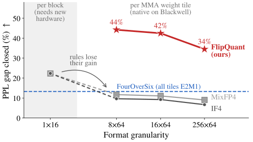

# FlipQuant: Gradient-Guided Hardware-Native MixFP4

Code for [**Gradient-Guided Hardware-Native MixFP4**](https://arxiv.org/abs/2611.18769) (arXiv:2611.18769).

FlipQuant picks a 4-bit format per Blackwell MMA tile (`8x64`, `16x64` or `256x64`): either E2M1 with FourOverSix
scaling, or the uniform grid E0M3. The choice is a one-bit map learned by gradient descent on the KL divergence to the
BF16 model. It runs on existing tensor cores. At 16x64 it closes 42.5% of NVFP4's perplexity gap to BF16, against
13.3% for FourOverSix. The GEMM overhead is 1.9% on SM120 (RTX PRO 6000) and 1.7% on SM100 (GB200, 256x64).

<p align="center"></p>

*Figure 1 of the paper: the share of NVFP4's perplexity gap to BF16 closed, averaged over WikiText-2, C4 and six
models. Per-block IF4 and MixFP4 need new hardware, and fall below FourOverSix at MMA-tile granularity.*

## Setup

```bash
git clone --recursive https://github.com/brian030128/flipquant && cd flipquant
conda env create -f experiments/paper_1k/env/n16k64.yml && conda activate n16k64   # torch 2.9, transformers 5.16.1
hf auth login                                       # the Llama models are gated
python -m experiments.paper_1k.setup fetch          # the paper's maps and GPTQ codes from the Hub
python -m experiments.paper_1k.setup kernels        # build the SM120 kernels (needs the mixfp4-cuda131 env's CUDA 13.1)
```

`n16k64-fast.yml` adds the recurrent-layer kernels that Nemotron-Nano-9B-v2 and Qwen3.8-27B need.

## Usage

```bash
# calibrate a map (the paper's settings; add --teacher-host for Qwen3.8-27B)
python -m calibration.train_map --model mistral-7b --unit 16x64 \
    --fit-windows 1024 --epochs 5 --teacher-topk 1000 --out runs/mistral-7b_16x64

# evaluate it
M="--mode native --weight mixfp4 --map runs/mistral-7b_16x64/map.pt"
python -m evaluation.ppl --model mistral-7b $M --paper-convention --out out/ppl.json   # WikiText-2, C4
python -m evaluation.downstream --model mistral-7b $M --tasks appendix --out out/mc.json  # 7 multiple-choice tasks
python -m evaluation.downstream --model mistral-7b $M --tasks gsm8k_llama --apply-chat-template --out out/gsm8k.json
python -m evaluation.latency prefill --model mistral-7b $M --out out/prefill.json
```

**Modes:**
- `--mode bf16`: the unquantized model.
- `--mode fake`: simulated quantization, on any CUDA GPU.
- `--mode native`: the FP4 kernels, on SM120. For SM100, add `--native-backend sm100-tuned`.

**Baselines:** `--weight nvfp4 --act nvfp4`, `--weight fourover6`, `--ptq gptq` and `--rotate hadamard`. IF4
(`--weight if4`) and MixFP4 (`--weight zou_mixfp4`) take `--unit <tile>` and run with `--mode fake` only.

## Reproducing the paper

Each result has a resumable driver, `python -m experiments.paper_1k.run <item>`. It checks itself against the
published record before the long run. Setup, gates and run times are in
[`results/paper_1k/RUNBOOK.md`](results/paper_1k/RUNBOOK.md).

| paper | code |
|---|---|
| Table 2, Fig. 1 (perplexity) | `evaluation.ppl`, `evaluation.significance` |
| Table 3, App. E (accuracy) | `evaluation.downstream`; MMLU: `item1` |
| Table 4 (prefill latency) | SM120: `item2`; GB200: `kernels/scripts/prefill_*_gb200.sbatch` |
| Table 5 (map-selection ablation) | `item3` |
| App. A.4 (native vs simulated) | `item6`; SM100: `kernels/scripts/ppl_native_vs_sim_gb200.sbatch` |
| App. B (per-block rules on tiles) | `scripts/table2.py`, `scripts/table2_zou.py` |
| App. C (calibration cost, robustness) | `item11`, `item12` |
| App. D (kernels: dispatch, GEMM time, SM100, read-back) | `item5`, `item7`–`item9`; SM100: `kernels/scripts/` |
| App. F (gradient check; GPTQ and Hadamard) | `item13`, `item4` |

Tests: `pytest tests`. Tests that need a GPU, built kernels or cached models skip themselves.

## Citation

```bibtex
@article{chen2026flipquant,
  title   = {Gradient-Guided Hardware-Native {MixFP4}},
  author  = {Chen, Jian-Jia and Chan, Brian J. and Lee, Wen-Hung and Li, Yi-Ting and Chen, Po-Shen and Kuo, Kuan-Te
             and Huang, Hsien-Cheng and Yu, Cody Hao and Chang, Chi-Chih and Abdelfattah, Mohamed S. and Wu, Kai-Chiang},
  journal = {arXiv preprint arXiv:2611.18769},
  year    = {2026}
}
```
